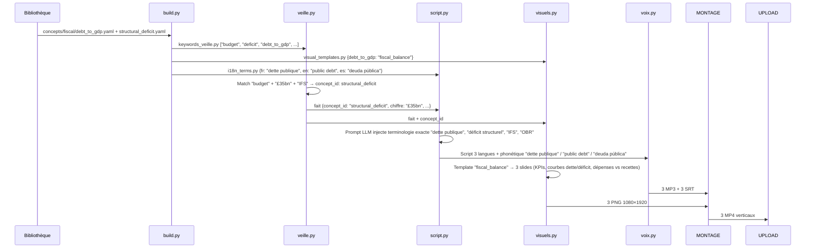

# Schéma d'Architecture — Bibliothèque Terminologique → Pipeline

```mermaid
flowchart TB
    %% ===== SOURCE UNIQUE =====
    subgraph TERM[📚 BIBLIOTHÈQUE TERMINOLOGIQUE]
        CONCEPTS[(concepts/*.yaml\n~110 fiches)]
        DOMAINS[domains.yaml\n15 domaines]
        ALIASES[aliases.yaml\nmatching veille]
        TEMPLATES[visual_templates.yaml\n14 templates]
        MULTI[multilingual/fr,en,es.yaml]
    end

    %% ===== BUILD =====
    BUILD[🔨 build.py\nGénérateur]
    
    %% ===== ARTIFACTS GÉNÉRÉS =====
    subgraph ARTIFACTS[📦 ARTIFACTS POUR PIPELINE]
        KW[keywords_veille.py\n{kw: [concept_ids]}]
        VT[visual_templates.py\n{concept_id: {template, params}}]
        I18N[i18n_terms.py\n{lang: {concept_id: label}}]
        GLOSS[glossaire.md\nDocumentation humaine]
    end

    %% ===== MODULES PIPELINE =====
    subgraph PIPELINE[🚀 MODULES PIPELINE]
        VEILLE[pipeline/veille.py\nVeille RSS]
        SCRIPT[pipeline/script.py\nGénération script LLM]
        VISUELS[pipeline/visuels.py\nGraphiques Matplotlib]
        VOIX[pipeline/voix.py\nEdge-TTS + SRT]
        MONTAGE[pipeline/montage.py\nFFmpeg]
        NOTIF[pipeline/notif.py\nTelegram]
        UPLOAD[pipeline/upload.py\nYouTube API]
    end

    %% ===== FLUX =====
    CONCEPTS --> BUILD
    DOMAINS --> BUILD
    ALIASES --> BUILD
    TEMPLATES --> BUILD
    MULTI --> BUILD
    
    BUILD --> KW
    BUILD --> VT
    BUILD --> I18N
    BUILD --> GLOSS
    
    KW --> VEILLE
    VT --> VISUELS
    I18N --> SCRIPT
    I18N --> VOIX
    
    VEILLE -->|fait_du_jour| SCRIPT
    VEILLE -->|fait_du_jour| VISUELS
    SCRIPT -->|script_3_langues| VOIX
    SCRIPT -->|titre/description| NOTIF
    SCRIPT -->|titre/description| UPLOAD
    VISUELS -->|slides_png| MONTAGE
    VOIX -->|audio_mp3 + srt| MONTAGE
    MONTAGE -->|video_mp4| NOTIF
    MONTAGE -->|video_mp4| UPLOAD
    NOTIF -->|validation humaine| UPLOAD
    
    %% ===== SORTIES =====
    UPLOAD --> YT[(YouTube\n3 playlists FR/EN/ES)]
    NOTIF --> TG[📱 Telegram\nAperçu + boutons]
```

---

## Détail des Connexions

| Artefact | Module | Utilisation |
|----------|--------|-------------|
| `keywords_veille.py` | `veille.py` | Matching sémantique pondéré (domaine + score) au lieu de simples regex |
| `visual_templates.py` | `visuels.py` | Sélection auto du template (`rate_cycle`, `fiscal_balance`, etc.) + params |
| `i18n_terms.py` | `script.py` | Terminologie exacte FR/EN/ES injectée dans le prompt LLM |
| `i18n_terms.py` | `voix.py` | Prononciation phonétique (IPA) pour Edge-TTS |
| `glossaire.md` | Humain | Revue éditoriale, onboarding, cohérence |

---

## Exemple Concret : Fait "Budget UK £35bn"



---

## Matrice Couverture

| Domaine | Concepts | Template Visuel | Mots-clés Veille | Termes FR/EN/ES |
|---------|----------|-----------------|------------------|-----------------|
| `monetary` | 12 | `rate_cycle` | 45 | 36 |
| `fiscal` | 10 | `fiscal_balance` | 38 | 30 |
| `inflation` | 8 | `inflation_dashboard` | 25 | 24 |
| `labor` | 8 | `labor_market` | 30 | 24 |
| `growth` | 6 | `generic` | 20 | 18 |
| `banking` | 8 | `generic` | 28 | 24 |
| `commodities` | 10 | `commodity_price` | 40 | 30 |
| `fx` | 8 | `fx_rate` | 25 | 24 |
| `equities` | 6 | `equity_index` | 22 | 18 |
| `rates` | 8 | `yield_curve` | 30 | 24 |
| `trade` | 6 | `trade_balance` | 18 | 18 |
| `housing` | 6 | `housing_market` | 20 | 18 |
| `energy` | 8 | `energy_transition` | 30 | 24 |
| `inequality` | 6 | `inequality` | 18 | 18 |
| `emerging` | 8 | `emerging_risk` | 25 | 24 |
| **TOTAL** | **~110** | **14 templates** | **~414** | **~330** |

---

## Avantages de cette Architecture

1. **Source unique** : Un changement de terme se propage à tous les modules
2. **Cohérence multilingue** : FR/EN/ES alignés par construction
3. **Visuels experts** : Template adapté au concept (pas de générique forcé)
4. **Veille intelligente** : Score pondéré par domaine + confirmations croisées
4. **Maintenabilité** : 1 concept = 1 fichier YAML, reviewable, versionné
5. **Extensibilité** : Nouveau domaine = nouveaux fichiers, pas de refactoring code