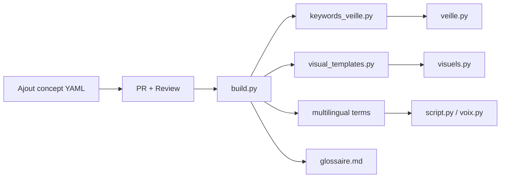

# Bibliothèque Terminologique Économique — Spécification

> **Objectif** : Source unique de vérité pour tous les modules (veille, script, visuels, voix)  
> **Format** : YAML/JSON versionné, multilingue (FR/EN/ES), extensible  
> **Usage** : `veille.py` (matching sémantique), `script.py` (terminologie exacte), `visuels.py` (template par concept), `voix.py` (prononciation)

---

## 1. Architecture

```
terminology/
├── concepts/                 # 1 fichier par concept
│   ├── monetary/
│   │   ├── policy_rate.yaml
│   │   ├── deposit_facility.yaml
│   │   └── ...
│   ├── fiscal/
│   │   ├── debt_to_gdp.yaml
│   │   ├── structural_deficit.yaml
│   │   └── ...
│   └── ...
├── domains.yaml              # Liste des 15 domaines + métadonnées
├── aliases.yaml              # Mapping alias → concept_id (pour veille)
├── visual_templates.yaml     # Mapping concept → template visuel
├── multilingual/
│   ├── fr.yaml              # Termes FR + prononciation
│   ├── en.yaml              # Termes EN + prononciation
│   └── es.yaml              # Termes ES + prononciation
└── build.py                  # Génère keywords_veille.py, visual_templates.py, glossaire.md
```

---

## 2. Schéma d'un Concept (niveau 2)

```yaml
# concepts/monetary/policy_rate.yaml
concept_id: "policy_rate"
domain: "monetary"
label:
  fr: "Taux directeur"
  en: "Policy rate"
  es: "Tipo de interés oficial"
synonyms:
  fr: ["taux de refinancement", "taux repo", "taux de base", "taux d'intérêt officiel"]
  en: ["policy rate", "refi rate", "base rate", "fed funds rate", "discount rate"]
  es: ["tipo de referencia", "tasa de interés oficial", "tasa de política monetaria"]
definition:
  fr: "Taux auquel la banque centrale prête aux banques commerciales pour refinancer leur liquidité"
  en: "Rate at which the central bank lends to commercial banks to refinance their liquidity"
  es: "Tipo al que el banco central presta a los bancos comerciales para refinanciar su liquidez"
data_sources:
  - id: "ECB_REFI"
    name: "ECB Refinancing Operations"
    url: "https://www.ecb.europa.eu/mopo/implement/omo/html/index.en.html"
    frequency: "weekly"
    series: "ECBREFIN"
  - id: "FED_FUNDS"
    name: "Federal Funds Rate"
    url: "https://fred.stlouisfed.org/series/FEDFUNDS"
    frequency: "daily"
    series: "FEDFUNDS"
  - id: "BOE_BANK_RATE"
    name: "Bank of England Bank Rate"
    url: "https://www.bankofengland.co.uk/monetary-policy/the-interest-rate-bank-rate"
    frequency: "meeting (8/year)"
decision_calendar:
  - "ECB: 6 semaines (jeudi)"
  - "Fed/FOMC: 8 réunions/an"
  - "BoE: 8 réunions/an"
  - "BCE: 8 réunions/an"
visual_template: "rate_cycle"
visual_params:
  history_years: 10
  show_neutral_estimate: true
  show_projections: true
  show_dots_plot: true
impact_channels:
  - "credit"
  - "fx"
  - "bonds"
  - "equities"
  - "housing"
related_concepts:
  - "deposit_facility"
  - "marginal_lending_facility"
  - "corridor_width"
  - "forward_guidance"
  - "quantitative_easing"
tags_veille:
  fr: ["taux directeur", "taux de refinancement", "politique monétaire", "BCE", "Fed", "Banque d'Angleterre"]
  en: ["policy rate", "refinancing rate", "monetary policy", "ECB", "Fed", "BoE"]
  es: ["tipo de interés oficial", "tasa de referencia", "política monetaria", "BCE", "Fed"]
```

---

## 3. Les 15 Domaines (niveau 1)

| Code | Label FR | Label EN | Label ES | Concepts cibles |
|------|----------|----------|----------|-----------------|
| `monetary` | Politique monétaire | Monetary policy | Política monetaria | 12 |
| `fiscal` | Finances publiques | Fiscal policy | Política fiscal | 10 |
| `inflation` | Inflation & prix | Inflation & prices | Inflación y precios | 8 |
| `labor` | Marché du travail | Labor market | Mercado laboral | 8 |
| `growth` | Croissance & cycles | Growth & cycles | Crecimiento y ciclos | 6 |
| `banking` | Banques & système financier | Banking & financial system | Banca y sistema financiero | 8 |
| `commodities` | Matières premières | Commodities | Materias primas | 10 |
| `fx` | Devises & changes | Currencies & FX | Divisas y tipos de cambio | 8 |
| `equities` | Marchés actions | Equity markets | Mercados de renta variable | 6 |
| `rates` | Obligations & taux | Bonds & rates | Bonos y tipos de interés | 8 |
| `trade` | Commerce international | International trade | Comercio internacional | 6 |
| `housing` | Immobilier | Real estate | Inmobiliario | 6 |
| `energy` | Énergie & climat | Energy & climate | Energía y clima | 8 |
| `inequality` | Inégalités & social | Inequality & social | Desigualdad y social | 6 |
| `emerging` | Pays émergents / Afrique | Emerging / Africa | Emergentes / África | 8 |

**Total visé : ~110 concepts** (extensible à 200+)

---

## 4. Templates Visuels par Concept

Chaque concept déclare son `visual_template` parmi la liste standardisée :

| Template | Description | Slides | Exemples concepts |
|----------|-------------|--------|-------------------|
| `rate_cycle` | Courbe taux + projections + dots plot | 3 | policy_rate, deposit_facility |
| `fiscal_balance` | Dette/PIB + déficit + dépenses/recettes | 3 | debt_to_gdp, structural_deficit |
| `inflation_dashboard` | IPC total/core + anticipations + composantes | 3 | cpi, core_inflation, hcpi |
| `labor_market` | Chômage + salaires + postes vacants + participation | 3 | unemployment_rate, wage_growth |
| `commodity_price` | Prix spot + stocks + courbe forward | 3 | gold, brent, copper |
| `fx_rate` | Spot + base monetair + carry + PPP | 3 | eur_usd, dollar_index |
| `yield_curve` | Courbe taux + spread 10y-2y + breakeven | 3 | us_10y, bund_10y, spread |
| `equity_index` | Index + PER + secteurs + flux | 3 | sp500, cac40, stoxx600 |
| `credit_spread` | Spread corporate/high yield + CDS | 3 | ig_spread, hy_spread |
| `housing_market` | Prix + accessibilité + crédit immo | 3 | house_prices, mortgage_rates |
| `trade_balance` | Balance courante + termes échange + IDE | 3 | current_account, terms_of_trade |
| `energy_transition` | Capacité renouvelable + prix électricité + carbone | 3 | renewable_capacity, carbon_price |
| `inequality` | Gini + revenus déciles + pauvreté | 3 | gini, income_share_top10 |
| `emerging_risk` | Spreads souverains + réserves + notation | 3 | em_spread, reserves, rating |
| `generic` | Fallback 3 slides (KPI + courbe + impact) | 3 | Tous les autres |

---

## 5. Génération Automatique (build.py)

```python
# build.py — Génère les artefacts pour les modules pipeline
import yaml, json
from pathlib import Path

def build_all():
    concepts = load_all_concepts()
    
    # 1. keywords_veille.py — pour veille.py
    keywords = {}
    for c in concepts:
        for lang in ["fr", "en", "es"]:
            for kw in c.get("tags_veille", {}).get(lang, []):
                keywords.setdefault(kw.lower(), []).append(c["concept_id"])
    
    # 2. visual_templates.py — pour visuels.py
    templates = {}
    for c in concepts:
        templates[c["concept_id"]] = {
            "template": c.get("visual_template", "generic"),
            "params": c.get("visual_params", {}),
        }
    
    # 3. multilingual terms — pour script.py / voix.py
    terms = {"fr": {}, "en": {}, "es": {}}
    for c in concepts:
        for lang in ["fr", "en", "es"]:
            terms[lang][c["concept_id"]] = c["label"][lang]
    
    # 4. glossaire.md — documentation humaine
    # ...
```

---

## 6. Intégration Modules Pipeline

| Module | Utilisation |
|--------|-------------|
| `veille.py` | `keywords_veille.py` → matching sémantique pondéré par domaine |
| `script.py` | `multilingual/terms` → terminologie exacte + définitions contextuelles |
| `visuels.py` | `visual_templates.py` → sélection template + paramètres |
| `voix.py` | `multilingual/pronunciation` → phonétique IPA par terme |

---

## 7. Workflow de Maintenance



### Règles de contribution
1. **1 concept = 1 fichier YAML** dans `concepts/<domain>/`
2. **Review obligatoire** : définition sourcée, synonymes vérifiés, template visuel choisi
3. **Tests** : `build.py` doit passer sans erreur
4. **Versioning** : SemVer (MAJOR = breaking template, MINOR = nouveau concept, PATCH = correction terme)

---

## 8. Prochaines Étapes

| Étape | Action | Livrable |
|-------|--------|----------|
| **1** | Créer structure dossiers + `domains.yaml` | Arborescence prête |
| **2** | Peupler **monetary** (12 concepts) + **fiscal** (10) | 22 concepts core |
| **3** | `build.py` + test intégration `veille.py` | Matching sémantique opérationnel |
| **4** | Peupler **inflation** + **labor** + **commodities** | ~50 concepts |
| **5** | Templates visuels spécialisés pour chaque domaine | Visuels experts |
| **6** | Multilingue complet FR/EN/ES + prononciation | Scripts/Voix natifs |

---

## 9. Exemple Complet — `policy_rate.yaml`

Voir section 2 ci-dessus.

---

## 10. Questions Ouvertes

1. **Granularité** : Séparer `fed_funds_rate` et `ecb_refi_rate` (2 concepts) ou un seul `policy_rate` avec `jurisdiction` ?
2. **Sources** : Lier chaque indicateur à sa série FRED/OECD/ECB exacte (code série) ?
3. **Historique** : Garder les anciennes définitions (ex: définition du chômage avant 2020) ?
4. **Validation** : Script auto-test qui vérifie que chaque concept a au moins 1 source, 1 template, 3 langues ?

---

*Document vivant — À mettre à jour à chaque ajout de concept.*